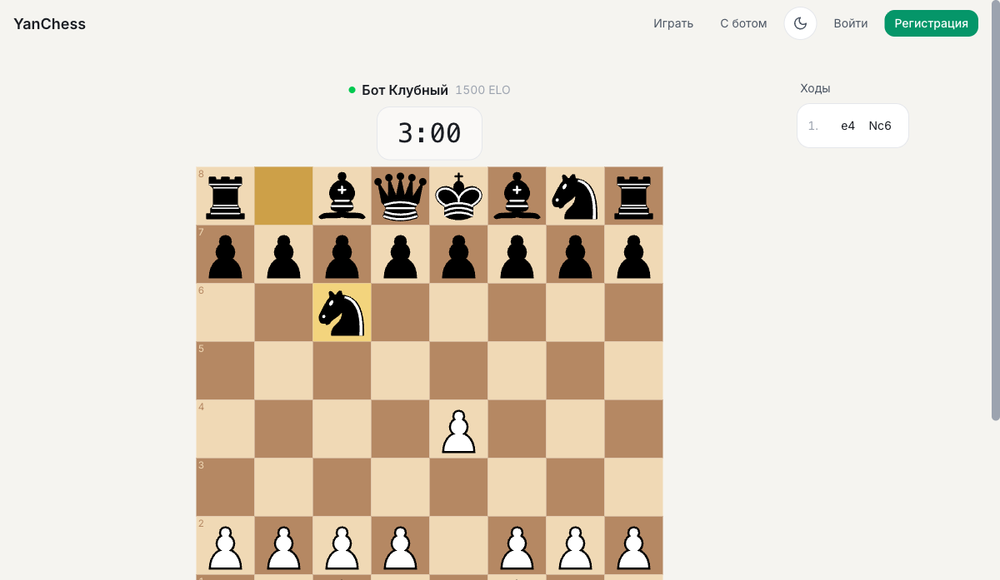

# YanChess

[](https://github.com/yantsyferov/yan-chess/actions/workflows/deploy.yml)

Chess platform MVP for amateur and club-level players. Play against the Stockfish bot, find a human opponent via matchmaking by rating, challenge friends directly, review your games.

**🌐 Live:** [https://yan-chess.com](https://yan-chess.com)



---

## Features

- **Play vs bot** — client-side Stockfish 19 WASM, 5 difficulty levels (800–2100 ELO), configurable time control + color.
- **Online matchmaking** — paired within ±200 ELO on your chosen mode (Bullet / Blitz / Rapid / Classical). Server-authoritative clocks + reconnection on refresh.
- **Friends + direct challenges** — nickname search, bidirectional friend requests, real-time presence indicator, invite a friend to a specific mode + color.
- **Game history + replay** — paginated list of your games with filters (mode, result), click any to replay move by move.
- **Classical ELO ratings** — K=32 for your first 30 games per mode, K=16 after.
- **Auth** — email + password (argon2), email verification via Resend, JWT access + Redis refresh tokens, forgot-password flow.

---

## Tech stack

- **Monorepo:** pnpm workspaces (`apps/web`, `apps/api`, `packages/shared`)
- **Frontend:** React 18, Vite, TypeScript, Tailwind v4, Zustand, Radix UI, react-chessboard, socket.io-client
- **Backend:** NestJS 10, Socket.IO, Prisma 5, Zod, Pino, SWC builder
- **Data:** PostgreSQL 16 (local docker-compose, prod via Neon), Redis 7 (local docker-compose, prod via Upstash)
- **Email:** Resend with verified domain
- **Deploy:** Fly.io (API + static web via Caddy), Docker multi-stage builds, Let's Encrypt TLS
- **Testing:** Vitest + Testing Library + Supertest + socket.io-client

**Test counts (current):** 113 api unit · 76 api e2e · 278 web.

---

## Quickstart (local dev)

```bash
# 1. Clone + install
git clone git@github.com:yantsyferov/yan-chess.git && cd yan-chess
pnpm install

# 2. Start Postgres + Redis
docker-compose up -d

# 3. Apply schema + create isolated test DB + seed demo users (alice/bob/charlie)
pnpm --filter api prisma:migrate:deploy
pnpm --filter api db:setup:test
pnpm --filter api seed:dev

# 4. Start the full dev loop (shared watcher + api + web, concurrently)
pnpm dev
```

Then open http://localhost:5173 and sign in as **alice@test.local** / **Password123!**.

Full local-dev conventions in `CLAUDE.md` (project-wide) + `apps/api/CLAUDE.md` + `apps/web/CLAUDE.md`.

---

## Production deployment

Live production runs on Fly.io. Full runbook with first-deploy steps, rollback, and known operational constraints: [`docs/DEPLOYMENT.md`](docs/DEPLOYMENT.md).

---

## Project context (for contributors / future me)

The project uses the **AWOS workflow** (`/awos:spec → /awos:tech → /awos:tasks → /awos:implement → /awos:verify`). Every feature is specified before coding; specs live at `context/spec/00N-<short-name>/`.

- `CLAUDE.md` (root) — project-wide conventions, hard rules, agent roster.
- `apps/api/CLAUDE.md` — backend patterns (RealtimeEmitter DI pattern, Prisma + Alpine binary targets, cookie options, Redis namespaces).
- `apps/web/CLAUDE.md` — frontend conventions (Zustand `wire()` idempotency, socket singletons, routes).
- `packages/shared/CLAUDE.md` — shared types + Zod schemas conventions.
- `context/product/architecture.md` — stack decisions with `[Confirmed]` / `[Assumption]` markers.
- `BACKLOG.md` — known deferred items, tech debt, operational TODOs.

11 specs shipped so far (001 Auth → 011 Production Deployment). History + Change Logs live under `context/spec/`.
